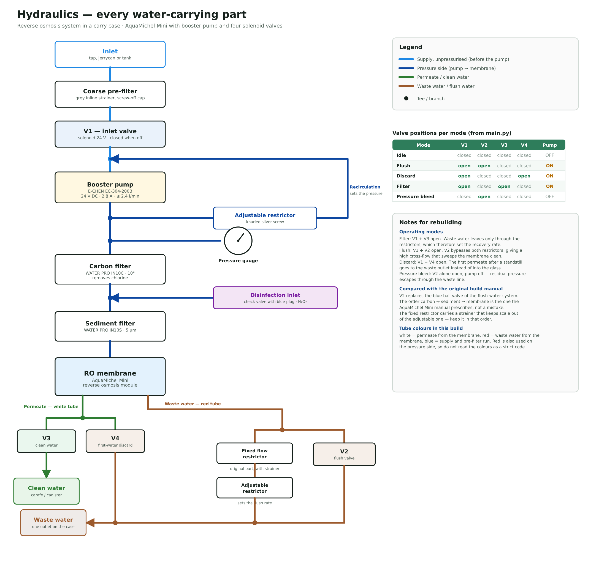
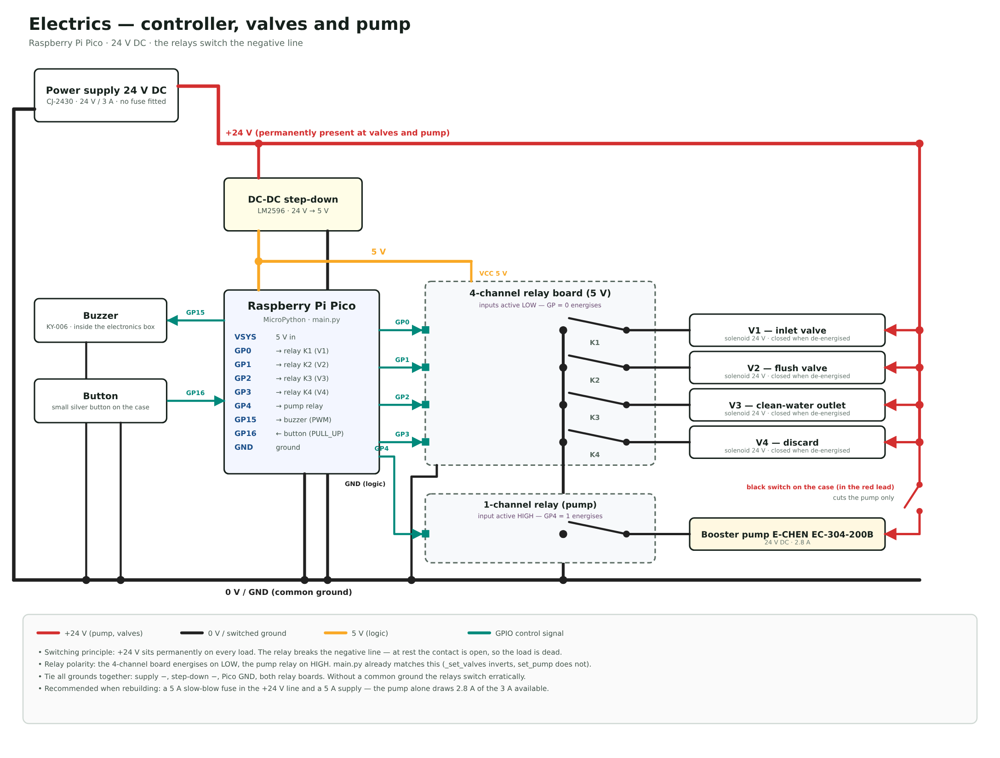

# Build schematics

Two drawings document the physical build inside the carry case. They are meant
for someone rebuilding the system from scratch, so they show the parts and the
connections between them — not the software state machine (that is
[flowchart.md](flowchart.md)).

Both exist in English and German. The layout is generated from one script, so
the two language versions are geometrically identical.

| | English | Deutsch |
|---|---|---|
| Water-carrying parts | [SVG](schematics/hydraulic-en.svg) · [PNG](../images/hydraulic-en.png) | [SVG](schematics/hydraulic-de.svg) · [PNG](../images/hydraulic-de.png) |
| Wiring | [SVG](schematics/electrical-en.svg) · [PNG](../images/electrical-en.png) | [SVG](schematics/electrical-de.svg) · [PNG](../images/electrical-de.png) |
| Both, for printing | [schematics-en.pdf](schematics/schematics-en.pdf) | [schematics-de.pdf](schematics/schematics-de.pdf) |

The PDFs hold both drawings on two A3 landscape pages. A3 rather than A4
because the hydraulic drawing stops being legible when it is squeezed that
small; printing A3 down to A4 is a checkbox in the print dialog, scaling up is
not.





## What the hydraulic drawing records

The flow path, in order: inlet (tap, jerrycan or tank) → grey inline strainer →
**V1** → tee → booster pump → tee. From that tee one branch runs through the
adjustable restrictor and back to the pump inlet — that recirculation loop is
what sets the working pressure. The other branch passes the tee carrying the
pressure gauge and continues to the carbon filter, then through the tee holding
the disinfection check valve (blue plug, the H₂O₂ injection point), then the
sediment filter, then the membrane.

The membrane has two outlets: permeate in the white tube, which tees to **V3**
(clean water out) and **V4** (discard), and waste water in the red tube, which
tees to the fixed restrictor + adjustable restrictor chain and to **V2**. All
three waste paths merge into the single waste outlet on the case.

Two points worth keeping when rebuilding:

- The pre-filter order is carbon → sediment → membrane. That is counterintuitive
  but it is what the AquaMichel Mini build manual prescribes.
- **V2 takes the place of the blue ball valve** in the original flush-water
  system: energising it bypasses both restrictors, which is what makes a flush a
  flush. The fixed restrictor carries a strainer that keeps scale out of the
  adjustable one, so keep the two in that order.

## What the electrical drawing records

+24 V sits permanently on all four valves and on the pump. Every relay contact
is in the **negative** line, so an inactive relay leaves its load dead. A black
switch on the outside of the case sits in the pump's red lead and cuts the pump
alone.

The relay polarity is not uniform and `main.py` already accounts for it: the
4-channel board energises on a LOW input (`_set_valves` writes the logical NOT
of its arguments) while the 1-channel pump relay energises on HIGH (`set_pump`
does not invert). See the pin map in [CLAUDE.md](../CLAUDE.md).

The drawing also carries two recommendations that the current build does not
have: a fuse in the +24 V line, and a supply with more headroom — the pump alone
draws 2.8 A of the 3 A the fitted CJ-2430 provides.

## Relation to the original design

This project started from an upstream repository whose schematic is still in the
tree as [images/schema.png](../images/schema.png):


That drawing documents a different machine and should not be used for rebuilding
this one. It differs in five ways that matter:

1. **No pump.** The upstream system runs on tap pressure, so it has no booster
   pump, no pressure gauge and no recirculation loop.
2. **Pre-filter order is reversed.** Upstream runs sediment (APEC CT-1SED) then
   carbon (CT-24CAB); this build runs carbon then sediment, which is what the
   AquaMichel Mini manual prescribes.
3. **Different cartridges.** APEC CT-1SED / CT-24CAB upstream, WATER PRO IN10C /
   IN10S here.
4. **Valves 3 and 4 are swapped.** Upstream numbers the permeate discard valve
   #3 and the clean-water valve #4. In `main.py` and on the hardware, V3 is clean
   water and V4 is the discard. V1 (inlet) and V2 (flush) mean the same thing in
   both.
5. **Parts that only exist here:** the inlet strainer, the H₂O₂ injection point
   after the carbon filter, the second (adjustable) restrictor in the waste line,
   and a single merged waste outlet instead of three separate disposal paths.

Point 4 is the one that bites: wiring the valves by the upstream numbering swaps
clean water and waste on the permeate side. The photo in the README shows the
pen markings on the brackets, which follow the numbering used in `main.py`.

## Regenerating

```bash
python3 docs/schematics/render.py --generate
```

`generate.py` writes the four SVGs; `render.py` then produces everything derived
from them — the PNGs in `images/` and the two print PDFs — so the checked-in
files stay in step with the sources. It needs a headless Chromium or Chrome on
`PATH`; otherwise point `CHROME` at one:

```bash
CHROME=/usr/lib/chromium/chromium python3 docs/schematics/render.py --generate
```

Run `generate.py` on its own if you only want to see the SVGs change.

Edit text in the `STRINGS` table at the bottom of `generate.py`; edit geometry
in `build_hydraulic` / `build_electrical`. Keep both languages in step — the
layout code is shared, so a string that grows too long will overflow in one
language and not the other. `DRAWINGS` in `render.py` carries the canvas sizes,
so change them in both places if you resize a drawing.
